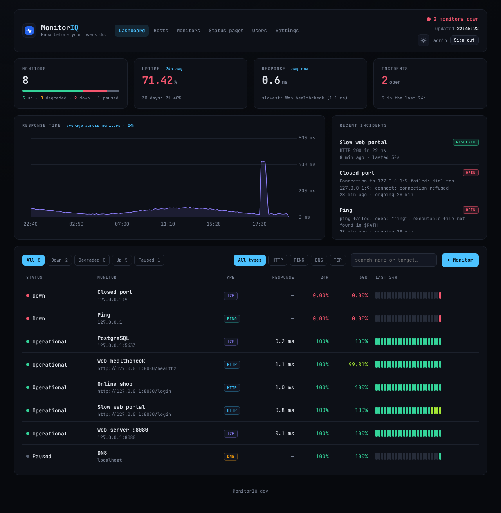

# MonitorIQ

**Know before your users do.**

Self-hosted uptime and service monitoring for **Rocky Linux 8, 9 and 10**.
A single Go binary with a dashboard, an admin back-office and public status pages, storing its data in **PostgreSQL** with configurable retention of up to **2 years**.

| Dark mode | Light mode |
|---|---|
|  |  |

## Features

| Check | What it verifies |
|---|---|
| **HTTP/HTTPS website** | Status code (e.g. `200-399`), keyword present/absent, response time (*degraded* above a threshold), valid certificate, redirects |
| **Ping (ICMP)** | Packet loss and min/avg/max RTT (partial loss = degraded) |
| **Traceroute** | Whether the destination is reached, hop count and RTT per hop (UDP or ICMP) |
| **DNS** | A, AAAA, CNAME, MX, TXT and NS records, with optional DNS server and expected value |
| **SMTP** | 220 banner, EHLO, STARTTLS or implicit TLS (465) |
| **TLS certificate expiry** | Days until expiry, chain and hostname; warns (degraded) when fewer than N days remain |
| **Custom TCP port** | Whether the port accepts connections and how fast |

- **Dashboard** with KPIs (monitors by status, average uptime, response time, open incidents), a 24-hour response-time chart, recent incidents and a monitor table with status/type filters, search and hour-by-hour availability bars.
- **Dark and light mode**: follows the operating system by default and can be toggled from the top bar (the choice is remembered in the browser).
- **Monitor page** with 24h/7d/30d/1-year uptime, a latency and availability chart from 1 hour to 2 years, last-check details (certificate, DNS answers, traceroute hops…), events and history.
- **Back-office** to manage hosts, monitors (interval, timeout, failures before alerting, pause), status pages, users and retention.
- **Public status pages** (`/status/<name>`) with overall status, 90-day availability bars, incidents from the last 14 days, custom public names and a JSON API (`/api/status/<name>`). They can be embedded in another site with an `<iframe>`.
- **Retention** configurable per data type, with a hard limit of 730 days:
  - raw results of every check (default 90 days);
  - hourly aggregates used by charts and long-term uptime (default 730 days);
  - events/incidents (default 730 days).
  Cleanup runs automatically every hour.
- **Security**: bcrypt passwords, server-side sessions, CSRF protection, login rate limiting, CSP headers, a hardened systemd unit and an unprivileged service user.

| Monitor | Public status page |
|---|---|
|  |  |

## Quick install (Rocky Linux 8 / 9 / 10)

### Option A: release package (recommended)

```bash
# Replace vX.Y.Z with the latest version from https://github.com/brainslad/monitoriq/releases
curl -LO https://github.com/brainslad/monitoriq/releases/download/vX.Y.Z/monitoriq-vX.Y.Z-linux-amd64.tar.gz
tar xzf monitoriq-vX.Y.Z-linux-amd64.tar.gz
cd monitoriq-vX.Y.Z-linux-amd64
sudo ./install.sh --open-firewall
```

### Option B: from source

```bash
sudo dnf install -y git
git clone https://github.com/brainslad/monitoriq.git
cd monitoriq
sudo ./install.sh --open-firewall      # installs Go (golang) and builds automatically
```

When it finishes, the installer prints the URL and the initial password of the `admin` user:

```
MonitorIQ installed successfully.
  URL:           http://192.0.2.10:8080
  Username:      admin
  Password:      9fK2…   (change it under Users after the first login)
```

### What the installer does

1. Installs `iputils` and `traceroute`.
2. Installs PostgreSQL (stream 16 on EL8/EL9 via dnf modules; native package on EL10), initialises it, creates the `monitoriq` database and role with a random password and enables `scram-sha-256` authentication on localhost.
3. Uses the bundled binary or builds it (Go ≥ 1.22).
4. Creates the `monitoriq` system user, installs `/usr/local/bin/monitoriq`, writes `/etc/monitoriq/monitoriq.env` and the `monitoriq.service` unit.
5. Applies database migrations, creates the `admin` user and starts the service.

Installer options:

| Option | Description |
|---|---|
| `--listen 0.0.0.0:8080` | Web server address and port |
| `--base-url https://status.example.com` | Public URL (used in status page links) |
| `--open-firewall` | Opens the port in firewalld |
| `--db-url postgres://…` | Use an existing PostgreSQL instead of installing a local one |
| `--pg-version 15` | PostgreSQL version to install (default 16) |
| `--build` | Build from source even if a binary is present |

**Upgrade:** download the new version and run `sudo ./install.sh` again. Configuration and data are kept and migrations are applied automatically.

**Uninstall:** `sudo ./uninstall.sh` (keeps data) or `sudo ./uninstall.sh --purge` (deletes the database and configuration).

## Usage

1. Open `http://<server>:8080` and sign in as `admin`.
2. **Hosts → New host**: enter a name and the address (hostname or IP).
3. Add **monitors** to that host. *Target* is optional: when empty the host address is used (for HTTP, `https://<address>`). *Port* 0 uses the type's default (443 for TLS, 25 for SMTP, 53 for DNS).
4. **Failures before alerting**: with 1, a monitor only turns *Down* after 2 consecutive failures, avoiding false alarms.
5. **Status pages → New**: pick the monitors, their public names and order. The page is served at `/status/<address>`.

### Statuses

- **Operational**: the check passed.
- **Degraded**: working but with problems (slow response, partial packet loss, certificate about to expire). Counts as available for uptime.
- **Down**: the check failed the configured number of times.
- **Unknown**: not checked yet, or paused.

### Authentication

The dashboard and back-office require a username and password. Status pages and their JSON API are public.
Sessions last 7 days and are stored in the database; cookies are HttpOnly, SameSite=Lax and Secure under HTTPS.
After 10 failed attempts an IP is blocked for 15 minutes. To reset a password on the server:

```bash
sudo -u monitoriq monitoriq --env /etc/monitoriq/monitoriq.env user set admin
```

### Command line

```bash
monitoriq serve                                # server (used by systemd)
monitoriq migrate                              # apply migrations
monitoriq user set admin                       # create a user / reset its password
monitoriq user list
monitoriq check http https://example.com       # one-off check, handy for diagnostics
monitoriq check tls example.com
monitoriq check dns example.com --config '{"record_type":"MX"}'
monitoriq check smtp mail.example.com 587 --config '{"smtp_tls":"starttls"}'
monitoriq check tcp example.com 3306
monitoriq version
```

## Configuration

File `/etc/monitoriq/monitoriq.env` (see [`deploy/monitoriq.env.example`](deploy/monitoriq.env.example)):

| Variable | Default | Description |
|---|---|---|
| `MONITORIQ_DATABASE_URL` | — | PostgreSQL connection |
| `MONITORIQ_LISTEN` | `127.0.0.1:8080` | Web server address |
| `MONITORIQ_BASE_URL` | — | Public URL, e.g. `https://status.example.com` |
| `MONITORIQ_TRUST_PROXY` | `false` | Trust `X-Forwarded-For`/`-Proto` (behind nginx) |
| `MONITORIQ_COOKIE_SECURE` | automatic | HTTPS-only cookies |
| `MONITORIQ_MAX_CONCURRENCY` | `50` | Concurrent checks |
| `MONITORIQ_DEBUG` | — | `1` logs every HTTP request |

After changing it: `sudo systemctl restart monitoriq`.

### HTTPS with nginx

Running MonitorIQ behind nginx with a Let's Encrypt certificate is recommended. The steps are in [`deploy/nginx/monitoriq.conf`](deploy/nginx/monitoriq.conf). In short: `MONITORIQ_LISTEN=127.0.0.1:8080`, `MONITORIQ_TRUST_PROXY=true`, `setsebool -P httpd_can_network_connect 1` and `certbot --nginx`.

## Database and retention

- Every check stores a raw result in `check_results` and incrementally updates an hourly aggregate in `check_results_hourly`.
- Charts up to 48h use raw results; up to 120 days hourly aggregates; beyond that daily aggregates. This keeps **2 years** of history cheap: a monitor checked every minute uses about 17,500 hourly rows over 2 years, versus over 1 million raw results.
- Periods are set under **Settings** (1 to 730 days). The 2-year limit is enforced in the UI and in the database.

**Backup:**

```bash
sudo -u postgres pg_dump -Fc monitoriq > monitoriq-$(date +%F).dump
# restore: sudo -u postgres pg_restore -d monitoriq --clean monitoriq-YYYY-MM-DD.dump
```

## Development

Requirements: Go ≥ 1.22 and PostgreSQL ≥ 12.

```bash
createdb monitoriq
cat > monitoriq.env <<'EOF'
MONITORIQ_DATABASE_URL=postgres://localhost/monitoriq?sslmode=disable
MONITORIQ_LISTEN=127.0.0.1:8080
EOF
make test
make run                 # http://127.0.0.1:8080 — with no users, 'admin' is created and its password is logged
make dist VERSION=v0.1.0 # builds dist/monitoriq-v0.1.0-linux-{amd64,arm64}.tar.gz
```

Layout:

```
cmd/monitoriq/          entry point and command line
internal/checks/        checks (http, ping, traceroute, dns, smtp, tls, tcp)
internal/scheduler/     concurrent scheduler and retention cleanup
internal/store/         PostgreSQL: migrations, queries, aggregates
internal/web/           HTTP server, templates, CSS/JS (embedded in the binary)
deploy/                 systemd unit, example configuration and nginx
install.sh              installer for Rocky Linux 8/9/10
```

To publish a release: `git tag v0.3.0 && git push --tags`. The `.github/workflows/release.yml` workflow builds the amd64/arm64 packages and creates the GitHub release.

## License

[GNU GPL v3 or later](LICENSE). You may use, modify and redistribute MonitorIQ; modified versions you distribute must keep the same license and make their source code available.

Bundles [Chart.js](https://www.chartjs.org/) (MIT) and the [JetBrains Mono](https://www.jetbrains.com/lp/mono/) font (SIL OFL 1.1). See [NOTICE](NOTICE).
