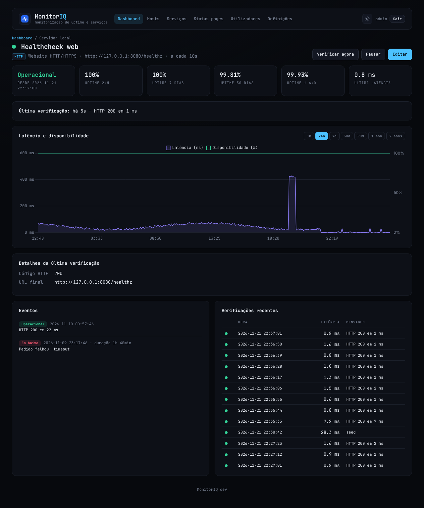

# MonitorIQ

Sistema de monitorização de uptime e serviços, auto-alojado, para **Rocky Linux 8, 9 e 10**.
Um único binário (Go) com dashboard, backoffice e status pages públicas, a guardar os dados em **PostgreSQL** com retenção configurável até **2 anos**.

*Self-hosted uptime & service monitoring for Rocky Linux 8/9/10: HTTP(S), ping, traceroute, DNS, SMTP, TLS certificate expiry and custom TCP ports, with a dashboard, an admin back-office and public status pages. Single Go binary + PostgreSQL. The UI is in Portuguese.*

| Modo escuro | Modo claro |
|---|---|
|  |  |

## Funcionalidades

| Verificação | O que confirma |
|---|---|
| **Website HTTP/HTTPS** | Código de resposta (ex.: `200-399`), palavra-chave presente/ausente, tempo de resposta (estado *degradado* acima de um limite), certificado válido, redirecionamentos |
| **Ping (ICMP)** | Perda de pacotes e RTT mín./médio/máx. (perda parcial = degradado) |
| **Traceroute** | Se o destino é alcançado, número de saltos e RTT de cada salto (UDP ou ICMP) |
| **DNS** | Registos A, AAAA, CNAME, MX, TXT e NS, com servidor DNS opcional e valor esperado |
| **SMTP** | Banner 220, EHLO, STARTTLS ou TLS implícito (465) |
| **Validade de certificado TLS** | Dias até expirar, cadeia e nome; aviso (degradado) quando faltam menos de N dias |
| **Porta TCP personalizada** | Se a porta indicada aceita ligações e em quanto tempo |

- **Dashboard** com indicadores (serviços por estado, uptime médio, tempo de resposta, incidentes abertos), gráfico do tempo de resposta das últimas 24h, incidentes recentes e tabela de serviços com filtros por estado e tipo, pesquisa e barras de disponibilidade hora a hora.
- **Modo escuro e modo claro**: segue o sistema por omissão e pode ser alternado no botão do topo (a escolha fica guardada no browser).
- **Página de cada serviço** com uptime 24h/7d/30d/1 ano, gráfico de latência e disponibilidade de 1 hora a 2 anos, detalhes da última verificação (certificado, respostas DNS, saltos do traceroute…), eventos e histórico.
- **Backoffice** para gerir hosts, serviços (intervalo, timeout, nº de falhas antes de marcar como em baixo, pausa), status pages, utilizadores e retenção.
- **Status pages públicas** (`/status/<nome>`) com estado geral, barras de disponibilidade de 90 dias, incidentes dos últimos 14 dias, nomes públicos personalizados e API JSON (`/api/status/<nome>`). Podem ser incorporadas noutro site com `<iframe>`.
- **Retenção** configurável por tipo de dado, com limite rígido de 730 dias:
  - resultados detalhados de cada verificação (predefinido 90 dias);
  - agregados horários usados nos gráficos e no uptime de longo prazo (predefinido 730 dias);
  - eventos/incidentes (predefinido 730 dias).
  A limpeza corre automaticamente de hora a hora.
- Segurança: palavras-passe com bcrypt, sessões no servidor, proteção CSRF, limite de tentativas de login, cabeçalhos CSP, serviço systemd endurecido e utilizador sem privilégios.

| Serviço | Status page pública |
|---|---|
|  |  |

## Instalação rápida (Rocky Linux 8 / 9 / 10)

### Opção A: pacote de release (recomendado)

```bash
# Substitua vX.Y.Z pela versão mais recente em https://github.com/brainslad/monitoriq/releases
curl -LO https://github.com/brainslad/monitoriq/releases/download/vX.Y.Z/monitoriq-vX.Y.Z-linux-amd64.tar.gz
tar xzf monitoriq-vX.Y.Z-linux-amd64.tar.gz
cd monitoriq-vX.Y.Z-linux-amd64
sudo ./install.sh --open-firewall
```

### Opção B: a partir do código fonte

```bash
sudo dnf install -y git
git clone https://github.com/brainslad/monitoriq.git
cd monitoriq
sudo ./install.sh --open-firewall      # instala o Go (golang) e compila automaticamente
```

No fim, o instalador mostra o endereço e a palavra-passe inicial do utilizador `admin`:

```
MonitorIQ instalado com sucesso.
  Endereço:      http://192.0.2.10:8080
  Utilizador:    admin
  Palavra-passe: 9fK2…   (altere-a em Utilizadores após o primeiro login)
```

### O que o instalador faz

1. Instala `iputils` e `traceroute`.
2. Instala o PostgreSQL (stream 16 em EL8/EL9 via módulos dnf; pacote nativo em EL10), inicializa-o, cria a base de dados e o utilizador `monitoriq` com uma palavra-passe aleatória e ativa autenticação `scram-sha-256` em localhost.
3. Usa o binário do pacote ou compila-o (Go ≥ 1.22).
4. Cria o utilizador de sistema `monitoriq`, instala `/usr/local/bin/monitoriq`, escreve `/etc/monitoriq/monitoriq.env` e o serviço `monitoriq.service`.
5. Aplica as migrações da base de dados, cria o utilizador `admin` e arranca o serviço.

Opções do instalador:

| Opção | Descrição |
|---|---|
| `--listen 0.0.0.0:8080` | Endereço e porta do servidor web |
| `--base-url https://status.exemplo.pt` | URL público (links das status pages) |
| `--open-firewall` | Abre a porta no firewalld |
| `--db-url postgres://…` | Usa um PostgreSQL existente em vez de instalar um local |
| `--pg-version 15` | Versão do PostgreSQL a instalar (predefinido 16) |
| `--build` | Compila a partir do código mesmo que exista binário |

**Atualizar:** descarregue a nova versão e volte a executar `sudo ./install.sh`. A configuração e os dados são mantidos e as migrações são aplicadas automaticamente.

**Remover:** `sudo ./uninstall.sh` (mantém dados) ou `sudo ./uninstall.sh --purge` (apaga a base de dados e a configuração).

## Utilização

1. Entre em `http://<servidor>:8080` com o utilizador `admin`.
2. **Hosts → Novo host**: indique um nome e o endereço (hostname ou IP).
3. Adicione os **serviços** desse host. O campo *Alvo* é opcional: se ficar vazio usa o endereço do host (para HTTP é usado `https://<endereço>`). A *Porta* 0 usa a predefinida do tipo (443 para TLS, 25 para SMTP, 53 para DNS).
4. **Falhas antes de alertar**: com o valor 1, o serviço só passa a *Em baixo* após 2 falhas seguidas, evitando falsos alarmes.
5. **Status pages → Nova**: escolha os serviços, os nomes públicos e a ordem. A página fica em `/status/<endereço>`.

### Estados

- **Operacional**: a verificação passou.
- **Degradado**: funciona mas com problemas (resposta lenta, perda parcial de pacotes, certificado prestes a expirar). Conta como disponível no uptime.
- **Em baixo**: a verificação falhou o número de vezes configurado.
- **Desconhecido**: ainda não verificado ou pausado.

### Linha de comandos

```bash
monitoriq serve                                # servidor (usado pelo systemd)
monitoriq migrate                              # aplica migrações
monitoriq user set admin                       # cria utilizador / redefine palavra-passe
monitoriq user list
monitoriq check http https://exemplo.pt        # verificação pontual, útil para diagnóstico
monitoriq check tls exemplo.pt
monitoriq check dns exemplo.pt --config '{"record_type":"MX"}'
monitoriq check smtp mail.exemplo.pt 587 --config '{"smtp_tls":"starttls"}'
monitoriq check tcp exemplo.pt 3306
monitoriq version
```

Para usar o comando no servidor com a configuração instalada:
`sudo -u monitoriq monitoriq --env /etc/monitoriq/monitoriq.env user set admin`

## Configuração

Ficheiro `/etc/monitoriq/monitoriq.env` (ver [`deploy/monitoriq.env.example`](deploy/monitoriq.env.example)):

| Variável | Predefinição | Descrição |
|---|---|---|
| `MONITORIQ_DATABASE_URL` | — | Ligação ao PostgreSQL |
| `MONITORIQ_LISTEN` | `127.0.0.1:8080` | Endereço do servidor web |
| `MONITORIQ_BASE_URL` | — | URL público, ex.: `https://status.exemplo.pt` |
| `MONITORIQ_TRUST_PROXY` | `false` | Confiar em `X-Forwarded-For`/`-Proto` (atrás de nginx) |
| `MONITORIQ_COOKIE_SECURE` | automático | Cookies só por HTTPS |
| `MONITORIQ_MAX_CONCURRENCY` | `50` | Verificações em simultâneo |
| `MONITORIQ_DEBUG` | — | `1` regista cada pedido HTTP |

Depois de alterar: `sudo systemctl restart monitoriq`.

### HTTPS com nginx

Recomenda-se publicar o MonitorIQ atrás de nginx com certificado Let's Encrypt. Os passos estão em [`deploy/nginx/monitoriq.conf`](deploy/nginx/monitoriq.conf). Em resumo: `MONITORIQ_LISTEN=127.0.0.1:8080`, `MONITORIQ_TRUST_PROXY=true`, `setsebool -P httpd_can_network_connect 1` e `certbot --nginx`.

## Base de dados e retenção

- Cada verificação grava um resultado detalhado em `check_results` e atualiza de forma incremental um agregado por hora em `check_results_hourly`.
- Gráficos até 48h usam os resultados detalhados; até 120 dias usam os agregados horários; acima disso agregados diários. Assim é possível manter **2 anos** de histórico com pouco espaço: um serviço verificado a cada minuto ocupa cerca de 17 500 linhas horárias em 2 anos, contra mais de 1 milhão de resultados detalhados.
- Os períodos são definidos em **Definições** (1 a 730 dias). O limite de 2 anos é imposto na interface e na base de dados.

**Cópia de segurança:**

```bash
sudo -u postgres pg_dump -Fc monitoriq > monitoriq-$(date +%F).dump
# restauro: sudo -u postgres pg_restore -d monitoriq --clean monitoriq-AAAA-MM-DD.dump
```

## Desenvolvimento

Requisitos: Go ≥ 1.22 e PostgreSQL ≥ 12.

```bash
createdb monitoriq
cat > monitoriq.env <<'EOF'
MONITORIQ_DATABASE_URL=postgres://localhost/monitoriq?sslmode=disable
MONITORIQ_LISTEN=127.0.0.1:8080
EOF
make test
make run                 # http://127.0.0.1:8080 — sem utilizadores, é criado 'admin' e a palavra-passe aparece no log
make dist VERSION=v0.1.0 # gera dist/monitoriq-v0.1.0-linux-{amd64,arm64}.tar.gz
```

Estrutura:

```
cmd/monitoriq/          ponto de entrada e linha de comandos
internal/checks/        verificações (http, ping, traceroute, dns, smtp, tls, tcp)
internal/scheduler/     agendador concorrente e limpeza de retenção
internal/store/         PostgreSQL: migrações, consultas, agregados
internal/web/           servidor HTTP, templates, CSS/JS (embutidos no binário)
deploy/                 unidade systemd, exemplo de configuração e nginx
install.sh              instalador para Rocky Linux 8/9/10
```

Publicar uma versão: `git tag v0.1.0 && git push --tags`. O workflow `.github/workflows/release.yml` compila os pacotes amd64/arm64 e cria a release no GitHub.

## Licença

[GNU GPL v3 ou posterior](LICENSE). Pode usar, modificar e redistribuir o MonitorIQ; versões modificadas que distribuir têm de manter a mesma licença e disponibilizar o código-fonte.

Inclui [Chart.js](https://www.chartjs.org/) (MIT) e a fonte [JetBrains Mono](https://www.jetbrains.com/lp/mono/) (SIL OFL 1.1). Ver [NOTICE](NOTICE).
